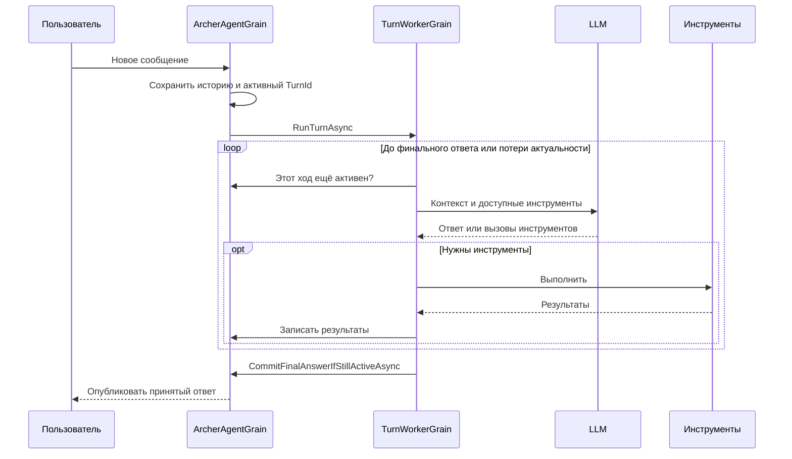

# Использование акторов в Archer и сравнение с Netclaw

Archer разделяет долгоживущее состояние агента и выполнение каждого отдельного хода между двумя Orleans grains. В Netclaw основным координатором остаётся persistent-актор диалога, а запросы к LLM и инструменты выполняются через асинхронные pipeline.

Обзор основан на исходниках Archer на коммите [`60b68b3`](https://github.com/davidatone/Archer/tree/60b68b39dcb3acf44b7e5f7fc60132dbc8f0215e). Сравнение с Netclaw относится к ранее рассмотренному коммиту `f8d2909`. Ссылки закреплены на этих версиях; описание не претендует на соответствие последующим изменениям проектов. Разбор Netclaw находится в [netclaw.md](netclaw.md).

## 1. Что в Archer называется агентом

Здесь нужно различать три сущности:

| Сущность | Назначение |
| --- | --- |
| `AgentDefinition` | Профиль: инструкции, модель, разрешённые инструменты, параметры контекста |
| `ArcherAgentGrain` | Конкретный экземпляр агента с ID, историей и сохранённым состоянием |
| `TurnWorkerGrain` | Исполнитель одного хода: обращается к модели и выполняет инструменты |

Например, профиль `code-scout` определён в YAML. Он задаёт исследователя репозитория с инструментами `list_files`, `grep`, `search_pattern`, `todo_list` и `memory.*`. В инструкциях описаны поиск прошлых знаний, исследование кода и сохранение найденного в память. Таким образом, специализация агента в основном задаётся данными, а механизм исполнения остаётся общим.

Источник: [code-scout.yaml](https://github.com/davidatone/Archer/blob/60b68b39dcb3acf44b7e5f7fc60132dbc8f0215e/agents/code-scout.yaml).

## 2. Как устроена работа двух grains

`ArcherAgentGrain` адресуется строковым `AgentId`. При активации он загружает состояние из хранилища.

При создании агента он:

1. Записывает первое пользовательское сообщение.
2. Создаёт `TurnId`.
3. Устанавливает текущий активный ход.
4. Сохраняет состояние.
5. Получает `TurnWorkerGrain` по этому `TurnId` и запускает его без ожидания завершения.

Сам `ArcherAgentGrain` не ждёт LLM, поэтому может принимать новые сообщения пользователя, пока отдельный worker работает. Это основная причина такого разделения.

Источник: [ArcherAgentGrain.cs](https://github.com/davidatone/Archer/blob/60b68b39dcb3acf44b7e5f7fc60132dbc8f0215e/src/Archer.Actors/Grains/ArcherAgentGrain.cs).



## 3. Что делает исполнитель хода

`TurnWorkerGrain` содержит обычный асинхронный цикл:

- Проверяет актуальность своего хода.
- Загружает состояние и профиль агента.
- Собирает контекст.
- Вызывает модель.
- Если получены tool calls — выполняет их последовательно, добавляет результаты и повторяет обращение к модели.
- Если получен финальный ответ — предлагает владельцу состояния сохранить его.

Инструменты выполняются через `IToolRegistry`. Они не являются отдельными grains. LLM вызывается через `IModelTurnRunner`, реализация которого использует `IChatClient`. Автоматическое выполнение инструментов модельной библиотекой здесь намеренно не используется: worker должен сам проверять актуальность между операциями.

Источники: [TurnWorkerGrain.cs](https://github.com/davidatone/Archer/blob/60b68b39dcb3acf44b7e5f7fc60132dbc8f0215e/src/Archer.Actors/Grains/TurnWorkerGrain.cs), [AgentFrameworkModelTurnRunner.cs](https://github.com/davidatone/Archer/blob/60b68b39dcb3acf44b7e5f7fc60132dbc8f0215e/src/Archer.Model/AgentFramework/AgentFrameworkModelTurnRunner.cs).

## 4. Новое сообщение заменяет текущий ход

Archer использует правило *latest-turn-wins*.

Допустим, пользователь сначала пишет:

> Найди, как устроена авторизация.

А затем, пока модель работает:

> Сначала проверь только JWT validation.

`ArcherAgentGrain` сохраняет второе сообщение и создаёт новый ход. Старый worker может ещё физически работать, но его результат уже не должен стать актуальным ответом.

Проверка основана на паре:

```csharp
ActiveTurnId == turnId
    && ActiveTurnStartedAtSeq == messageSeq
```

Worker проверяет её перед итерациями, после ответа модели, до и после инструментов. Финальная проверка выполняется внутри владельца состояния, непосредственно в `CommitFinalAnswerIfStillActiveAsync`. Это закрывает промежуток между проверкой worker и записью ответа.

Источники: [AgentState.cs](https://github.com/davidatone/Archer/blob/60b68b39dcb3acf44b7e5f7fc60132dbc8f0215e/src/Archer.Domain/Agents/AgentState.cs), [ArcherAgentGrain.cs](https://github.com/davidatone/Archer/blob/60b68b39dcb3acf44b7e5f7fc60132dbc8f0215e/src/Archer.Actors/Grains/ArcherAgentGrain.cs).

### Границы защиты и отмены

- Запрет сохранить устаревший финальный ответ реализован явно.
- Уже совершённое внешнее действие эта проверка не отменяет.
- `RecordToolResultAsync` сам не проверяет актуальность: проверка находится у worker перед вызовом. Поэтому нельзя считать, что все записи защищены так же строго, как финальный ответ.

Есть и нюанс отмены: `CancelAsync` вызывается у того же worker, который исполняет длительный `RunTurnAsync`. В просмотренном коде grain не reentrant, а `CancelAsync` не помечен `AlwaysInterleave`. По правилам Orleans такой запрос обычно ждёт завершения текущего.

Вывод по коду: основная рабочая защита здесь — проверки актуальности; немедленное прерывание зависшего LLM-запроса этой схемой не гарантируется. Это вывод из исходников и правил планирования, без запуска эксперимента.

Источники: [контракт worker](https://github.com/davidatone/Archer/blob/60b68b39dcb3acf44b7e5f7fc60132dbc8f0215e/src/Archer.Actors/Contracts/ITurnWorkerGrain.cs), [планирование запросов Orleans](https://learn.microsoft.com/en-us/dotnet/orleans/grains/request-scheduling).

## 5. Чем отличается от Netclaw

| Аспект | Archer | Netclaw |
| --- | --- | --- |
| Владелец состояния | `ArcherAgentGrain` | `LlmSessionActor` |
| Исполнение основного цикла | Отдельный grain на каждый ход | Актор сессии координирует асинхронные pipeline |
| Новое сообщение во время работы | Делает старый ход устаревшим и запускает новый | В рассмотренном `Processing` принимается и буферизуется |
| Инструменты | Последовательно в worker | Pipeline поддерживает параллельный пакет |
| Хранение | `state.json`, журнал `events.ndjson`, отдельные файлы результатов | Akka.Persistence: события и snapshots в SQLite |
| Делегирование | `TurnWorkerGrain` исполняет ход того же агента | `SubAgentActor` получает отдельную делегированную задачу |
| Ответ модели | В просмотренной реализации `GetResponseAsync` получает ответ целиком | Pipeline обрабатывает потоковые части ответа |

Основания для сравнения: [хранилище Archer](https://github.com/davidatone/Archer/blob/60b68b39dcb3acf44b7e5f7fc60132dbc8f0215e/src/Archer.Persistence/FileAgentStateStore.cs), [worker Archer](https://github.com/davidatone/Archer/blob/60b68b39dcb3acf44b7e5f7fc60132dbc8f0215e/src/Archer.Actors/Grains/TurnWorkerGrain.cs), [актор сессии Netclaw](https://github.com/netclaw-dev/netclaw/blob/f8d2909fa272a316af6b4cb22893d209053c4938/src/Netclaw.Actors/Sessions/LlmSessionActor.cs), [pipeline инструментов Netclaw](https://github.com/netclaw-dev/netclaw/blob/f8d2909fa272a316af6b4cb22893d209053c4938/src/Netclaw.Actors/Sessions/Pipelines/SessionToolExecutionPipeline.cs), [подагент Netclaw](https://github.com/netclaw-dev/netclaw/blob/f8d2909fa272a316af6b4cb22893d209053c4938/src/Netclaw.Actors/SubAgents/SubAgentActor.cs).

Сохранение `state.json` в Archer позволяет восстановить историю, но само по себе не обеспечивает продолжение прерванного цикла с того же шага. `OnActivateAsync` загружает состояние, не перезапуская worker; промежуточный список результатов для текущего модельного цикла находится в памяти worker.

## Применение в akka-agent-lab

Для нашего проекта предлагается взять у Archer разделение владельца состояния и исполнителя, а также проверку `TurnId` при принятии результата. Политику новых сообщений стоит выбирать явно: ставить в очередь, как в рассмотренном Netclaw, либо заменять текущую работу, как в Archer. Для задач с изменением файлов или внешних систем к этому потребуется отдельная политика отмены и повторного выполнения.

Это предложение для `akka-agent-lab`, а не описание уже реализованной в нём функциональности.
