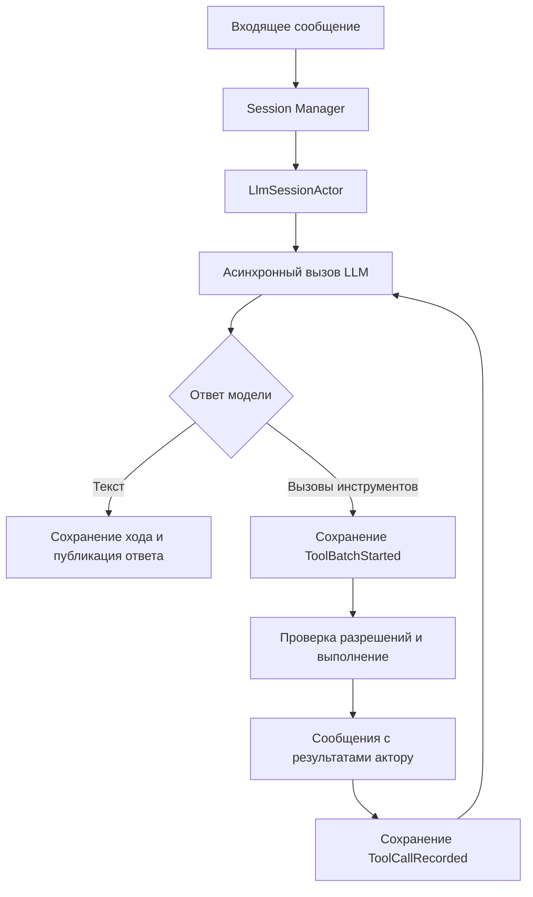

# Использование Akka.NET в Netclaw

Akka.NET в Netclaw управляет состоянием диалогов и выполнением работы агента: каждый диалог представлен отдельным актором, а результаты LLM и инструментов поступают ему сообщениями.

Обзор основан на исходниках ветки `dev`, коммит [`f8d2909`](https://github.com/netclaw-dev/netclaw/tree/f8d2909fa272a316af6b4cb22893d209053c4938). Ссылки закреплены на этом коммите; описание не претендует на соответствие последующим изменениям проекта.

## 1. Один диалог — один LlmSessionActor

Центральный класс наследуется от `ReceivePersistentActor`. Он хранит историю разговора, состояние текущего запроса, ожидающие входящие сообщения, вызовы инструментов и сведения о дочерних агентах.

У него пять фаз:

| Фаза | Что происходит |
| --- | --- |
| `Recovering` | Восстановление из журнала и snapshot |
| `Ready` | Ожидание нового запроса |
| `Processing` | Запрос к LLM или выполнение инструментов |
| `Compacting` | Сокращение контекста разговора |
| `Passivating` | Подготовка к остановке после простоя |

Переходы проверяются явно, а обработчики сообщений переключаются через `Become(...)`. Например, во время `Processing` новые пользовательские сообщения принимаются и буферизуются, а не запускают второй конкурирующий цикл поверх текущего.

Источники: [LlmSessionActor.cs](https://github.com/netclaw-dev/netclaw/blob/f8d2909fa272a316af6b4cb22893d209053c4938/src/Netclaw.Actors/Sessions/LlmSessionActor.cs), [SessionPhase.cs](https://github.com/netclaw-dev/netclaw/blob/f8d2909fa272a316af6b4cb22893d209053c4938/src/Netclaw.Actors/Sessions/SessionPhase.cs).

## 2. Менеджер сессий находит или создаёт нужного актора

При запуске регистрируется актор `session-manager`. Его реализация — `GenericChildPerEntityParent`.

Когда приходит сообщение с идентификатором сессии, он:

1. Извлекает ID.
2. Ищет дочернего актора с соответствующим именем.
3. Создаёт `LlmSessionActor`, если такого ребёнка ещё нет.
4. Пересылает сообщение через `Forward`, сохраняя отправителя.

Таким образом, разные диалоги получают разные акторы и независимое состояние. Здесь используется локальный паттерн «ребёнок на сущность»; наличие `IMessageExtractor` из Cluster.Sharding не означает, что включён кластер.

Источники: [регистрация акторов](https://github.com/netclaw-dev/netclaw/blob/f8d2909fa272a316af6b4cb22893d209053c4938/src/Netclaw.Actors/Hosting/NetclawAkkaHostingExtensions.cs), [GenericChildPerEntityParent.cs](https://github.com/netclaw-dev/netclaw/blob/f8d2909fa272a316af6b4cb22893d209053c4938/src/Netclaw.Actors/Hosting/GenericChildPerEntityParent.cs).

## 3. Вызов LLM выполняется вне обработчика состояния

Актор подготавливает историю и параметры и запускает `SessionLlmInvoker.InvokeAsync(...)`. Для обращения к модели используется `IChatClient` из `Microsoft.Extensions.AI`.

Асинхронный код возвращает данные через `self.Tell(...)`:

- `LlmResponseDeltaReceived` — очередная часть потокового ответа;
- `LlmResponseReceived` — собранный ответ;
- `LlmCallFailed` — ошибка.

Это позволяет актору продолжать принимать служебные сообщения во время ожидания модели. Изменения состояния остаются внутри обработчиков актора. Сообщения также несут `CallId`, позволяющий различать вызовы.

Источник: [SessionLlmInvoker.cs](https://github.com/netclaw-dev/netclaw/blob/f8d2909fa272a316af6b4cb22893d209053c4938/src/Netclaw.Actors/Sessions/Pipelines/SessionLlmInvoker.cs).

## 4. Агентный цикл построен вокруг ответов модели и результатов инструментов

Упрощённо путь запроса выглядит так:

Инструменты выполняет `SessionToolExecutionPipeline` через обычный `IToolExecutor`. Пакет вызовов может выполняться параллельно, а отдельные результаты возвращаются актору сообщениями. Актор сохраняет их и продолжает цикл обращения к модели.

Не каждый инструмент является актором: актор координирует выполнение и владеет состоянием, а конкретную операцию выполняет отдельный сервис.

Источники: [обработка ответов и инструментов](https://github.com/netclaw-dev/netclaw/blob/f8d2909fa272a316af6b4cb22893d209053c4938/src/Netclaw.Actors/Sessions/LlmSessionActor.cs), [SessionToolExecutionPipeline.cs](https://github.com/netclaw-dev/netclaw/blob/f8d2909fa272a316af6b4cb22893d209053c4938/src/Netclaw.Actors/Sessions/Pipelines/SessionToolExecutionPipeline.cs).

## 5. Persistence сохраняет прогресс диалога

У каждой сессии стабильный `PersistenceId`, построенный из её ID. В журнал попадают события, например:

- `InputAdmitted` — входящее сообщение принято;
- `ToolBatchStarted` — начат пакет вызовов;
- `ToolCallRecorded` — записан результат инструмента;
- `TurnRecorded` — записан ход разговора;
- `SessionCompacted` — контекст сокращён.

При восстановлении `Recover<T>()` применяет события к состоянию. Snapshot ускоряет этот процесс. В daemon для журнала и snapshot-store настроена SQLite через `Akka.Persistence.Sql`.

При этом восстановление истории не даёт гарантии однократного выполнения внешнего действия. В коде есть отдельные ветки для прерванных операций и неопределённых результатов после перезапуска.

Источники: [актор сессии](https://github.com/netclaw-dev/netclaw/blob/f8d2909fa272a316af6b4cb22893d209053c4938/src/Netclaw.Actors/Sessions/LlmSessionActor.cs), [конфигурация persistence](https://github.com/netclaw-dev/netclaw/blob/f8d2909fa272a316af6b4cb22893d209053c4938/src/Netclaw.Daemon/DaemonPersistenceConfiguration.cs).

## 6. Подагенты — дочерние акторы

Для делегированной задачи сессия создаёт дочерний `SubAgentActor` и вызывает `Context.Watch(child)`.

У подагента собственные история, модель и набор инструментов. Он получает `RunSubAgent`, выполняет свой цикл, возвращает `SubAgentResult` и останавливается. Сам `SubAgentActor` не persistent; сведения о запуске и завершении сохраняет родительская сессия. Если ребёнок остановился без итогового подтверждения, родитель фиксирует потерю исполнителя; автоматически повторять такую работу код не пытается.

Источники: [SubAgentActor.cs](https://github.com/netclaw-dev/netclaw/blob/f8d2909fa272a316af6b4cb22893d209053c4938/src/Netclaw.Actors/SubAgents/SubAgentActor.cs), [работа с дочерними агентами](https://github.com/netclaw-dev/netclaw/blob/f8d2909fa272a316af6b4cb22893d209053c4938/src/Netclaw.Actors/Sessions/LlmSessionActor.Children.cs).

## Применение в akka-agent-lab

Для нашего проекта предлагается прежде всего взять этот принцип: актор сессии владеет состоянием, LLM-клиент и инструменты выполняют асинхронную работу, результаты возвращаются сообщениями. Менеджер сессий, persistence и дочерние агенты можно добавлять по мере появления соответствующих задач.

Это предложение для `akka-agent-lab`, а не описание уже реализованной в нём функциональности.
